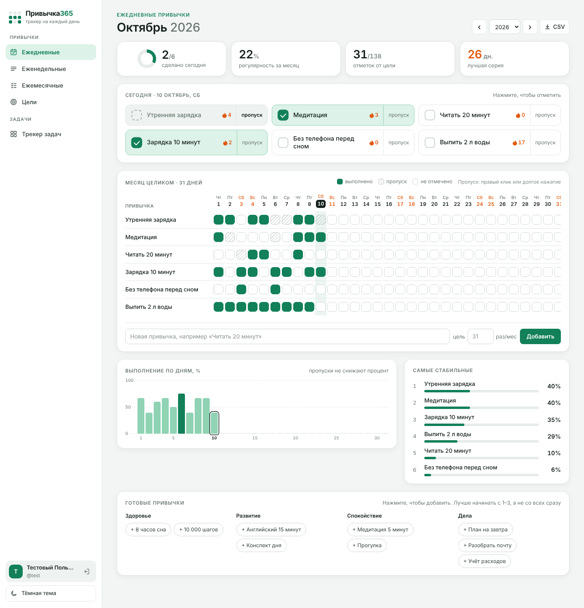

# Трекер Привычек + Трекер Задач — Flask-приложение

Локальное веб-приложение на Python (Flask) + SQLite, объединяющее два инструмента
по мотивам шаблонов «Трекер Привычек» и «Универсальный Трекер Задач»
(Google Sheets/Excel): привычки с автоматической аналитикой, трекер целей
и полноценный трекер задач с канбан-доской, матрицей Эйзенхауэра,
смарт-календарём и планерами.

Работает полностью offline — без внешних библиотек и CDN (все графики,
«пончики» и drag-and-drop — на чистых CSS/HTML5, без Chart.js и прочего).

## Скриншоты

### 1. Главная страница / Ежедневные привычки



### Трекер привычек
- **Ежедневные привычки** — сетка на весь месяц, до 30 привычек, цель на месяц,
  столбчатый график ежедневного прогресса, общий «пончик», ТОП-10 самых
  стабильных привычек.
- **Еженедельные привычки** — отметка по неделям месяца, донат и статистика
  по выбранной неделе.
- **Ежемесячные привычки** — чек-лист на месяц с зачёркиванием выполненного.
- **Трекер целей** — карточки целей по сферам жизни, награда, дедлайн, статус,
  чек-лист шагов, общий прогресс.

### Трекер задач
- **Задачи** — таблица со сроком, исполнителем, статусом, категорией,
  приоритетом, флагами «важно»/«срочно», редактирование прямо в ячейках,
  фильтры и поиск. Сверху — сводка (всего/в работе/выполнено/просрочено,
  срок ≤7/14/30 дней), донат прогресса, донат статусов, приоритеты и нагрузка
  по исполнителям.
- **Канбан-доска** — 5 колонок по статусам, карточки перетаскиваются мышью
  (HTML5 drag-and-drop), статус сохраняется сразу в базу.
- **Матрица Эйзенхауэра** — 4 квадранта (Сделать сейчас / Запланировать /
  Делегировать / Исключить), задачи распределяются автоматически по флагам
  важности и срочности, с фильтром по исполнителю.
- **Смарт-календарь** — месячная сетка с задачами по датам, подсветка
  сегодняшнего дня и просроченных задач.
- **Дневной и недельный планер** — расписание по часам (06:00–01:00),
  к любому слоту можно привязать открытую задачу, топ-3 приоритета дня
  и ближайшие дедлайны рядом.

### Общее
- **Светлая и тёмная тема** — переключатель внизу боковой панели,
  сохраняется в браузере (localStorage).
- Переход между месяцами/годами/неделями, добавление и удаление своих
  привычек, задач и целей прямо в интерфейсе.

## Установка и запуск

Нужен Python 3.9+ и Flask.

```bash
pip install flask
cd habit_tracker
python app.py
```

Приложение поднимется на `http://127.0.0.1:5000` — откройте эту ссылку
в браузере (Chrome, Safari, Firefox — без разницы).

При первом запуске автоматически создаётся `habit_tracker.db` рядом
с `app.py`, с примерами привычек, целей и задач (как на скриншотах-референсах) —
их можно удалить и завести свои.

## Структура проекта

```
habit_tracker/
├── app.py                 — Flask-приложение, все маршруты
├── database.py             — работа с SQLite, вся бизнес-логика подсчётов
│                             (привычки/цели в первой половине файла,
│                              задачи/канбан/матрица/календарь/планер — во второй)
├── habit_tracker.db        — база данных (создаётся автоматически)
├── templates/
│   ├── base.html            — общий каркас: меню, подменю трекера задач,
│   │                          переключатель темы
│   ├── daily.html            — ежедневные привычки
│   ├── weekly.html           — еженедельные привычки
│   ├── monthly.html          — ежемесячные привычки
│   ├── goals.html            — трекер целей
│   ├── tasks_list.html        — задачи: таблица + дашборд
│   ├── tasks_kanban.html      — канбан-доска
│   ├── tasks_matrix.html      — матрица Эйзенхауэра
│   ├── tasks_calendar.html    — смарт-календарь
│   └── tasks_planner.html     — дневной и недельный планер (один шаблон,
│                                переключается параметром mode)
└── static/
    ├── css/style.css          — все стили, включая обе темы
    └── js/app.js              — переключение темы + CSS-графики/донаты
```

## Как это устроено технически

- Один пользователь, локальная база SQLite — авторизация не нужна,
  это персональный инструмент.
- Все действия (чекбоксы, смена статуса, drag-and-drop, редактирование ячеек)
  идут через AJAX (`fetch`) — сохраняются мгновенно, без перезагрузки страницы;
  цифры/графики/донаты пересчитываются сразу.
- Проценты по дневным привычкам считаются как `выполнено / цель × 100`,
  где цель по умолчанию — число дней в месяце.
- Дедлайны и «осталось дней» у задач считаются на лету от текущей даты;
  просроченными считаются задачи со сроком в прошлом и статусом
  не «Выполнено».
- Матрица Эйзенхауэра — чистая функция от двух булевых флагов
  (`important`, `urgent`), пересчитывается при каждом изменении задачи.
- Канбан использует нативный HTML5 Drag and Drop API — без сторонних
  JS-библиотек.
- Графики (столбцы, «пончики», горизонтальные бары) сделаны на чистом CSS
  (`conic-gradient` для донатов, `flex`/`width`/`height` для столбцов и баров) —
  специально без Chart.js/D3 и CDN-зависимостей, чтобы приложение
  гарантированно работало без интернета.

## Возможные доработки на будущее

- Экспорт в Excel/CSV одним нажатием
- Уведомления/напоминания о дедлайнах
- Несколько профилей пользователей с авторизацией
- Годовая сводка по привычкам (сейчас аналитика — в рамках выбранного месяца)
- Настраиваемые тайм-слоты в планере (сейчас фиксированные 06:00–01:00,
  шаг 1 час)
