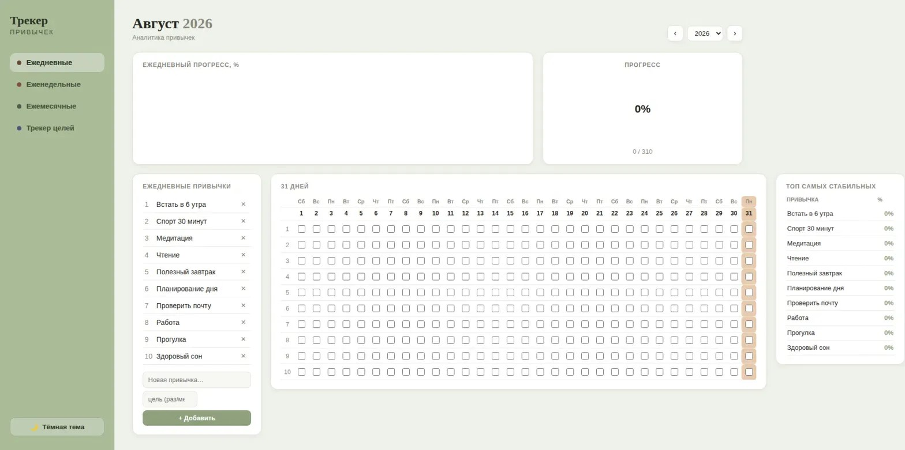
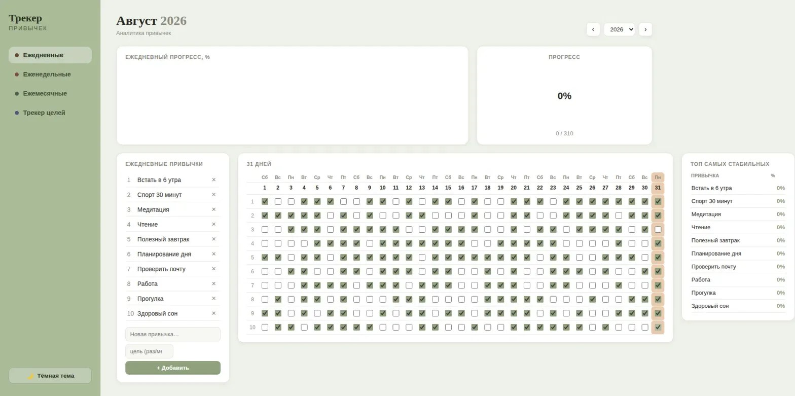
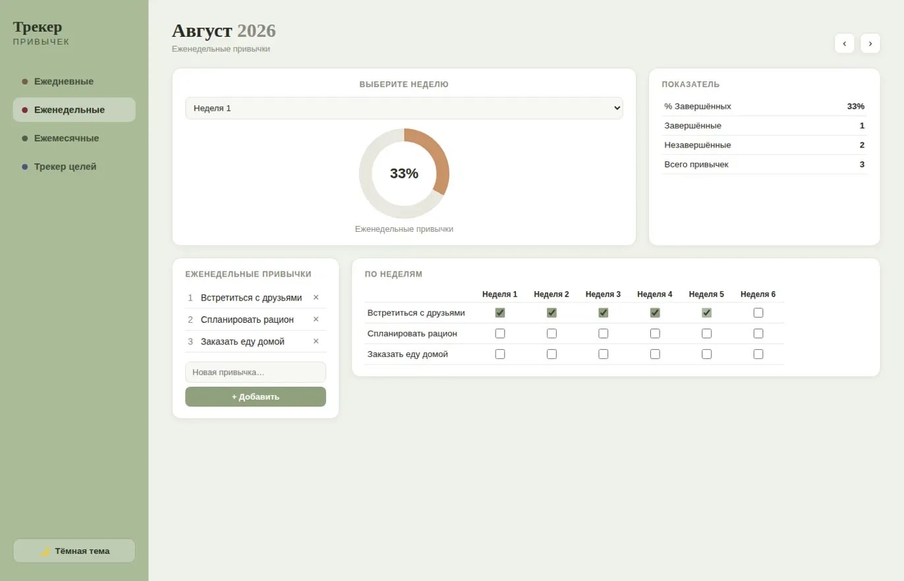
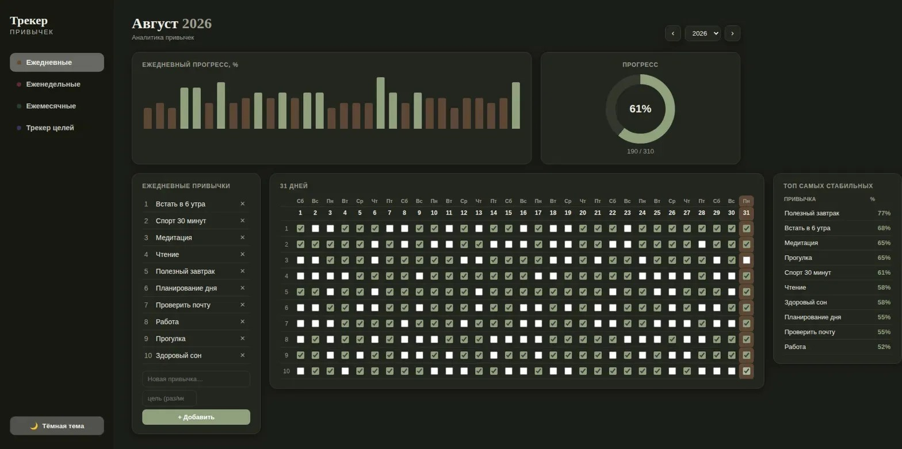
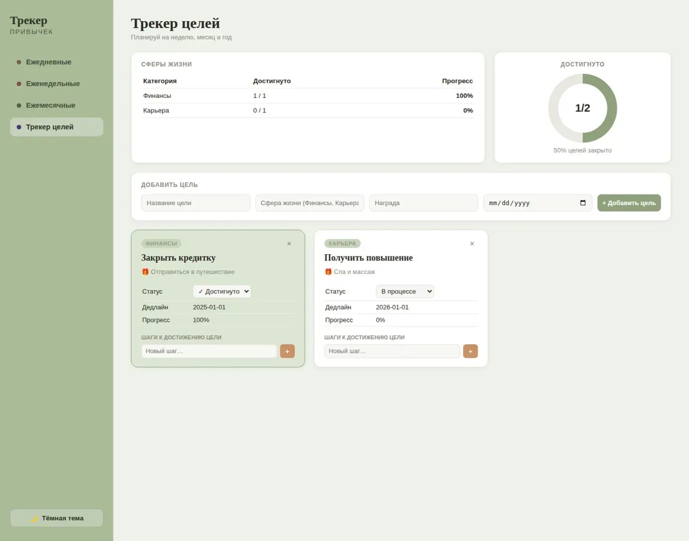

# Трекер Привычек — Flask-приложение

Локальный веб-трекер привычек и целей на Python (Flask) + SQLite.
Сделан по мотивам шаблона «Трекер Привычек» (Google Sheets/Excel): ежедневные,
еженедельные и ежемесячные привычки с автоматической аналитикой, плюс трекер целей.

Работает полностью offline — без внешних библиотек и CDN (графики и «пончики»
на чистом CSS, без Chart.js и прочего).

## Скриншоты

### 1. Главная страница / Ежедневные привычки


### 2. Еженедельные привычки


### 3. Ежемесячные привычки


### 4. Трекер целей


### 5. Тёмная тема



## Возможности

- **Ежедневные привычки** — сетка на весь месяц (чекбоксы по дням), до 30 привычек,
  у каждой можно задать цель (сколько раз в месяц), автоматический подсчёт %.
  Столбчатый график ежедневного прогресса, общий «пончик»-индикатор, ТОП-10
  самых стабильных привычек.
- **Еженедельные привычки** — отметка по неделям месяца (до 5–6 недель),
  выбор недели, донат и статистика по выбранной неделе.
- **Ежемесячные привычки** — простой чек-лист на месяц с зачёркиванием
  выполненных пунктов и донатом прогресса.
- **Трекер целей** (бонус) — карточки целей по сферам жизни (Финансы, Карьера,
  Здоровье…), награда за цель, дедлайн, статус, чек-лист шагов к цели,
  общий прогресс по всем целям.
- **Светлая и тёмная тема** — переключатель внизу боковой панели, сохраняется
  в браузере (localStorage).
- Переход между месяцами и годами, добавление/удаление своих привычек и целей
  прямо в интерфейсе.

## Установка и запуск

Нужен Python 3.9+ и Flask.

```bash
pip install flask
cd habit_tracker
python app.py
```

Приложение поднимется на `http://127.0.0.1:5000` — просто откройте эту ссылку
в браузере (Chrome, Safari, Firefox — не важно, всё работает через обычный
HTML/CSS/JS без спецтребований).

При первом запуске автоматически создаётся файл базы данных
`habit_tracker.db` рядом с `app.py`, с несколькими примерами привычек и целей
(как на скриншотах-референсах) — их можно удалить и завести свои.

## Структура проекта

```
habit_tracker/
├── app.py              — Flask-приложение, все маршруты
├── database.py          — работа с SQLite, вся бизнес-логика подсчётов
├── habit_tracker.db     — база данных (создаётся автоматически)
├── templates/
│   ├── base.html         — общий каркас (меню, переключатель темы)
│   ├── daily.html        — ежедневные привычки
│   ├── weekly.html        — еженедельные привычки
│   ├── monthly.html      — ежемесячные привычки
│   └── goals.html        — трекер целей
└── static/
    ├── css/style.css      — все стили, включая обе темы
    └── js/app.js          — переключение темы + CSS-графики/донаты
```

## Как это устроено технически

- Один пользователь, локальная база SQLite — никакой авторизации не нужно,
  это персональный инструмент (как исходная Excel/Google Sheets таблица).
- Все чекбоксы работают через AJAX (`fetch`) — отметка сохраняется мгновенно,
  без перезагрузки страницы, проценты/графики/донаты пересчитываются на лету.
- Проценты по дневным привычкам считаются как `выполнено / цель × 100`,
  где цель по умолчанию — число дней в месяце (если не задано вручную).
- Графики (столбцы и «пончики») сделаны на чистом CSS
  (`conic-gradient` для донатов, `flex` + `height` для столбцов) — специально
  без Chart.js/D3 и прочих CDN-зависимостей, чтобы приложение гарантированно
  работало без интернета.

## Возможные доработки на будущее

- Экспорт в Excel/CSV одним нажатием
- Уведомления/напоминания
- Несколько профилей пользователей с авторизацией
- Годовая сводка (сейчас аналитика — в рамках выбранного месяца)
